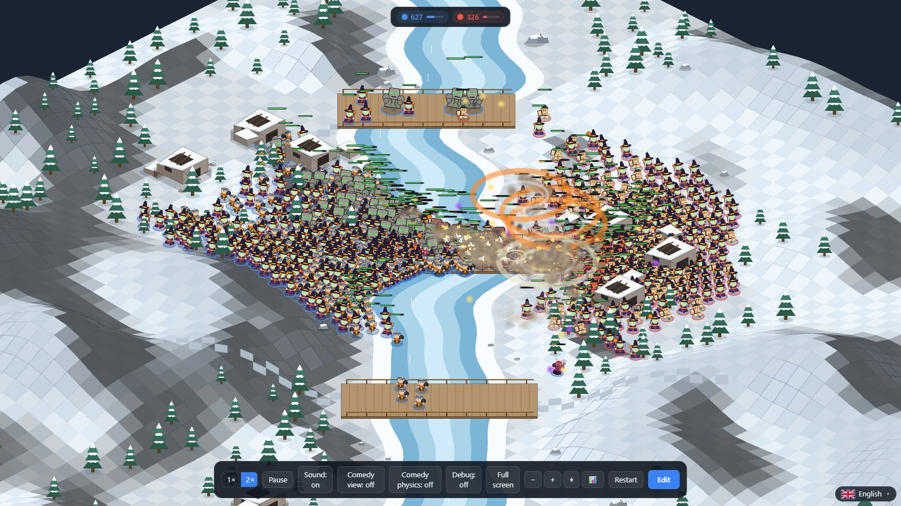
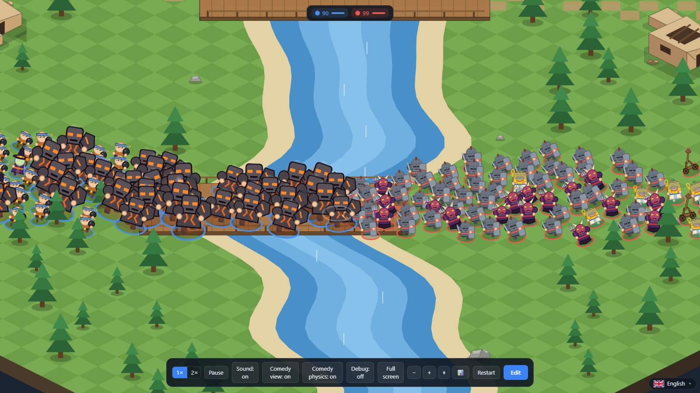
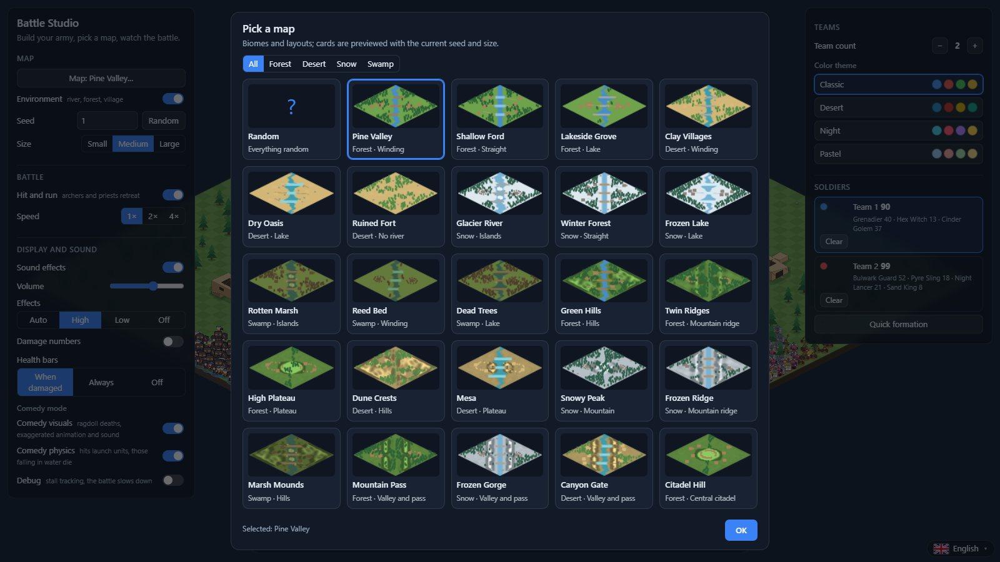
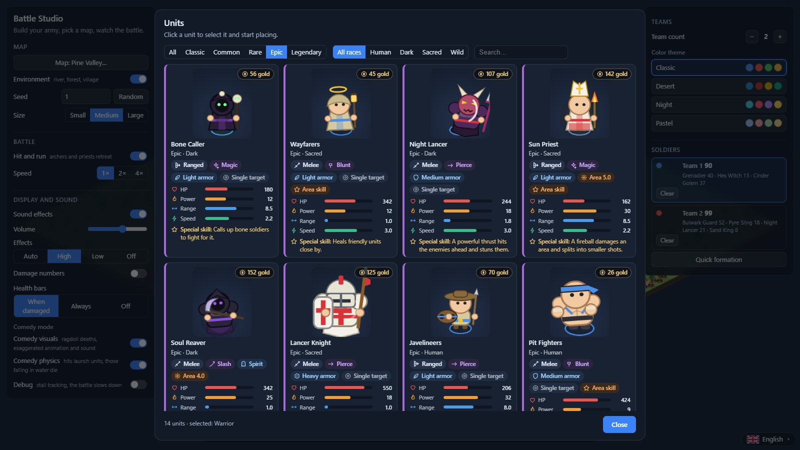
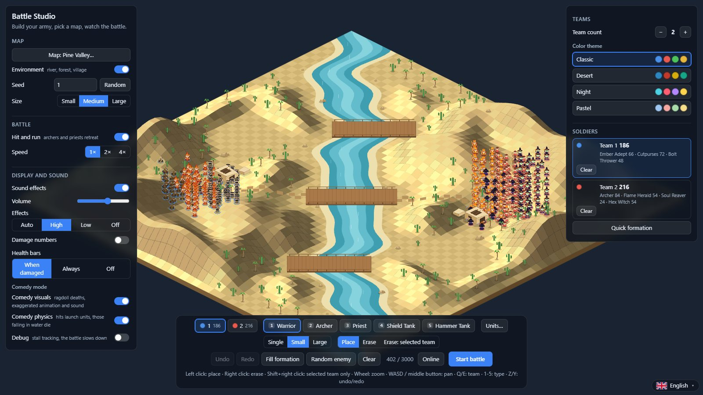
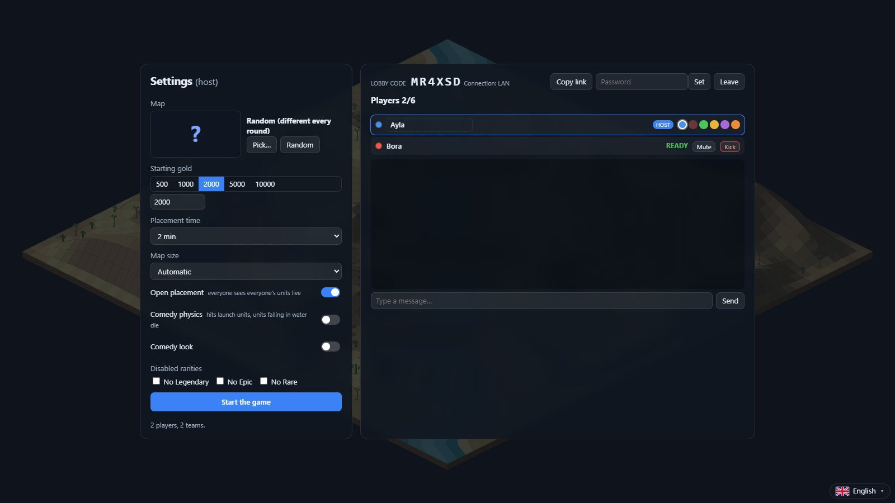
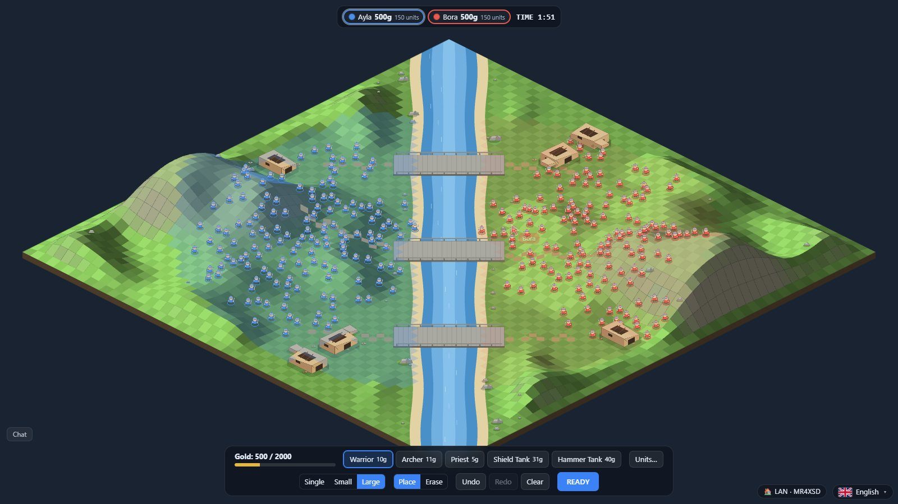
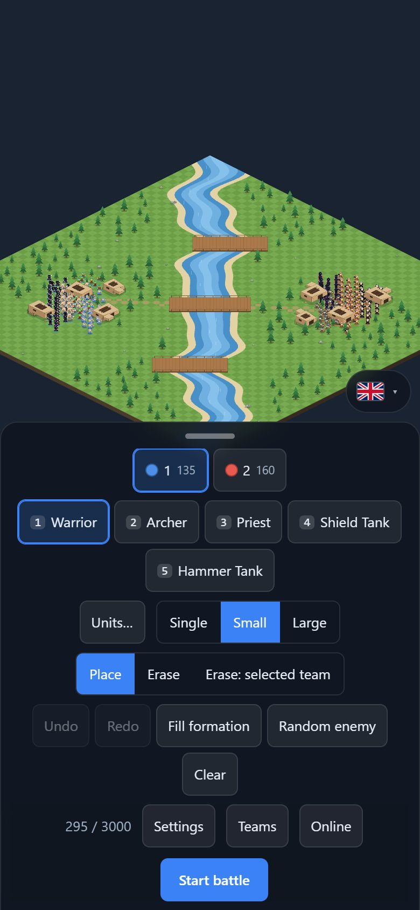
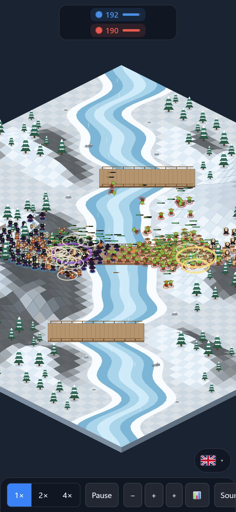

# RPG Web — Battle Studio

[](LICENSE)
[](LICENSING.md)
[](https://github.com/gkaragoz/rpg-web-strategy/actions/workflows/release.yml)
[](CONTRIBUTING.md)

An isometric auto-battle game that runs in the browser (PixiJS v8 + Vite + TypeScript). The simulation runs in a Web Worker;
a 20,000-soldier battle (10k vs 10k) runs at ~160 FPS. It has online play (LAN / internet, up to 6 players), touch
support for phones and tablets, 49 units, random maps and a bilingual UI (English / Türkçe).

**Play now:** https://gkaragoz.github.io/rpg-web-strategy/

<!-- screenshots:start (generated by `npm run screenshots`) -->
<p align="center">
  
</p>

<table>
  <tr><td align="center"><br /><sub>Comedy physics</sub></td><td align="center"><br /><sub>Map gallery</sub></td></tr>
  <tr><td align="center"><br /><sub>Unit gallery with attack previews</sub></td><td align="center"><br /><sub>Army studio</sub></td></tr>
  <tr><td align="center"><br /><sub>Online lobby</sub></td><td align="center"><br /><sub>Online placement</sub></td></tr>
  <tr><td colspan="2" align="center"> <br /><sub>Mobile: bottom sheet and battle HUD</sub></td></tr>
</table>
<!-- screenshots:end -->

## License

This project is **source-available, but closed to commercial use**. The source code is licensed under the
**[PolyForm Noncommercial License 1.0.0](LICENSE)** plus additional terms:

- ✅ You may play, read the source, and modify and share it for **noncommercial** purposes (personal use, hobby, education,
  research, charities and public institutions).
- ❌ You may **not** sell the project or derivatives of it, make money from it with ads, subscriptions or in-app purchases,
  or include it in a paid product or service (including paid server hosting). Commercial use requires written permission
  from the project owner.
- 📝 Every copy and modified version must keep the license and the **"© gkaragoz and Contributors"** notice, and a modified
  version must not misrepresent its origin (it may not use the "RPG Web / Battle Studio" name as if it were the official project).
- 🤝 Anyone is welcome to **contribute to the official project** ([CONTRIBUTING.md](CONTRIBUTING.md)); contributions are
  licensed to the project owner through the [CLA](CLA.md).
- Third-party libraries keep their own licenses: [THIRD_PARTY_NOTICES.md](THIRD_PARTY_NOTICES.md). A short summary of the
  whole structure is in [LICENSING.md](LICENSING.md).

> Open-source licenses such as the AGPL cannot stop commercial copying, which is why this license was chosen; the project is
> not "open source" in the OSI sense.

## Features

- Isometric auto-battles with up to 6 teams, 49 units (5 classics + 44 roster units), skills such as
  summoning, resurrection, healing, stuns, fear, shields, area and line damage.
- Map generator with biomes, rivers, forests, villages, relief and layouts (valley, central fortress, islands and bridges,
  crossroads), 21 presets and a fully random mode.
- **Online play:** host a lobby, friends join with a code; budget-based unit placement; deterministic lockstep simulation;
  spectators, reconnection, chat, player cursors. LAN, internet relay and WebRTC fallback.
- **Mobile:** touch controls, bottom-sheet toolbar, adaptive resolution.
- **Comedy mode:** ragdoll deaths, cartoon sounds, physics launches.
- Bilingual UI: English (default) and Türkçe, switchable from the flag dropdown at the bottom right.
- Unit gallery with automatic looping attack previews on every unit card.
- **Counters:** damage types (slash / pierce / blunt / magic) against armor classes (light / medium / heavy / spirit), area damage with falloff, crowd-control immunity; gold costs are calibrated by a headless, deterministic tournament (`npm run balance`).
- **Terrain that matters:** hills and mountains up to 8 steps high; climbing slows units by steepness, high ground gives damage and range, ridges block direct fire.

## Play / Install

**In the browser (no install):** https://gkaragoz.github.io/rpg-web-strategy/ — published automatically with every release.
On first load the page registers a service worker and reloads once (needed for SharedArrayBuffer / the worker simulation);
if that fails the simulation runs on the main thread.

**Install wizard (local server, works offline; needs Node.js 18+, the wizard offers to install it):**

| System | Command |
|---|---|
| macOS / Linux | `curl -fsSL https://github.com/gkaragoz/rpg-web-strategy/releases/latest/download/install.sh \| bash` |
| Windows (PowerShell) | `iwr -useb https://github.com/gkaragoz/rpg-web-strategy/releases/latest/download/install.ps1 \| iex` |
| Windows (double-click) | Download `install.bat` from the Releases page and run it |

The wizard asks for an install folder, downloads the latest release and creates launchers (`play.sh` / `play.bat` for local play,
`play-lan` for hosting a LAN lobby) and a desktop shortcut. Update: `install.sh --update` · Uninstall: `install.sh --uninstall`
(Windows: `-Update` / `-Uninstall`). Manually: unzip a release and run `node server.mjs app --open` (`scripts/server.mjs`,
dependency-free, sends the COOP/COEP headers).

**Releasing:** `git tag v1.x.y && git push origin v1.x.y` → `.github/workflows/release.yml` tests, builds, creates a GitHub
Release with the zip and the wizard files, and publishes to GitHub Pages.

## Development

Prerequisites: Node.js 18+ (22 recommended), npm, a modern browser.

```bash
npm install
npm run dev      # dev server (http://localhost:5173)
npm run build    # tsc + production build
npm run check    # tsc --noEmit + repo policy check + tests
npm run check:fast  # same, fast test subset (~10 s)
npm run screenshots # regenerate README screenshots (needs Chrome)
```

`SharedArrayBuffer` (the worker simulation) needs the server to send `Cross-Origin-Opener-Policy: same-origin` and
`Cross-Origin-Embedder-Policy: require-corp` (`vite.config.ts` does it for dev/preview; a production server needs it too).
Without them the simulation falls back to the main thread automatically.

## Usage

**Studio (home page):** map (environment, seed, size), kiting, speed, display/sound, unit settings, 2–6 teams, color
palette, soldier placement and a benchmark.

| Input | Action |
|---|---|
| Left click / drag | Place soldiers (brush: Single / Small / Large) |
| Right click / drag | Erase (Shift: only the selected team) |
| Q / E | Switch team · 1–5: soldier type · B: brush · X: place/erase |
| Ctrl+Z / Ctrl+Y (or Z / Y) | Undo / redo |
| Wheel, WASD, middle button | Zoom, pan |
| Space · R · Esc · 1-2-3 · F3 · V | (in battle) pause · restart · edit · speed · statistics · debug |

**Maps:** *Map → Choose map…* in the studio opens a preview gallery (21 presets, biome filter, *Customize* dropdowns, a
**Random** card: everything random + seed; *Reroll* / *Lock*). The recipe is a `MapSpec` (`src/sim/mapSpec.ts`) shared by the
simulation and the renderer; every map is symmetric around the center and both armies can reach each other.
- **Biome:** Forest, Desert, Snow, Swamp (ground, trees/cacti/snowy pines/dead trees, house style, water color).
- **Layout:** *Classic* (river + relief), **Valley and pass** (two high ridges, a single gate), **Central fortress** (ramped
  plateau, ring wall, towers, keep), **Islands and bridges** (two channels across the river + bridges), **Crossroads**
  (junction, hamlets).
- **Relief / elevation:** Flat, Hills, Ridge, Plateau, Mountain. Elevation is visual plus an uphill slowdown (at most 35%);
  a tile ≥ 1.5 steps higher than its neighbor is a cliff (impassable). The ground is drawn with sloped quads; units, decor
  and projectiles sit on the height.
- Options for river (winding, straight, islands, lakes, none), forest (dense, sparse, grove, ring forest, none), village
  (village, scattered houses, ruined fort, camp, none) and crossing (wooden bridge, stone bridge, shallow ford).

**Comedy mode** (in the spirit of Totally Accurate Battle Simulator; two independent switches — studio *Display and sound →
Comedy mode*, HUD buttons in battle, the `K` key, or `?comedy=1` for both):
- **Comedy look** (rendering/sound only, instant toggle): the dead fly off as **ragdolls**, bounce and slide, bodies that land
  in water sink (sometimes a hat or a star pops off); wobbly walking, squash-and-stretch on hits, stumbling; "BONK! / AAAH! /
  KABOOM!" texts, cartoon sounds (bonk, boing, wail, splat, whoosh), exaggerated effects, camera shake and zoom punch.
- **Comedy physics** (changes the simulation, restarts the battle): hits that take most of a unit's health, tank blows and
  area skills launch units on a parabola (up to 14 tiles); those landing in water **drown**, those landing on obstacles or
  cliffs are placed on the nearest walkable point, and landed units lie down briefly and crush whoever is underneath.
  With the mode off the simulation is not affected at all.

**Debug layer:** studio *Display and sound → Debugging*, the *Debug* HUD button or `V` in battle (the battle restarts with the same
layout), or `?debug=1`. The simulation runs on the main thread and the stall detector from the test suite watches the battle
live. A problem unit gets a pulsing red ring, a stuck unit an orange ring, a unit whose target was banned a purple ring; the
panel at the top left shows counters (stuck, active A* paths, banned, leash breaks) and the latest flags (`idleChaser`,
`cannotHit`, `oscillation`, `noProgress`...). Keys: `H` toggle layer · `T` target lines · `P` A* paths · `G` closed regions.

**URL parameters:** `?debug=1`, `?bench=10000&auto=30` (benchmark, report after 30 s), `?sim=main` (simulation on the main
thread), `?env=off` (no environment), `?kite=off` (kiting off), `?seed=3`, `?comedy=1`, `?lang=en|tr`.

## Online play

The **Online** button in the studio: choose a name and color, then **Host a lobby**, **Join with a code** or **Spectate**.

- **Lobby (host):** map (choose or *Random*), starting gold, placement time, map size, *Open placement* (everyone
  sees everyone's soldiers live), comedy physics/look, banned rarities, password; **kick / mute** players. Players = teams (max 6).
- **Game flow:** everyone clicks *Ready* → the host clicks *Start game* → everyone places soldiers in their own zone with a gold
  budget (every unit has an automatic gold cost) → the battle starts when everyone is *READY* or the time runs out. Speed and pause are
  **host-only**; they are locked for everyone else. After the battle the host can start a *Rematch*.
- **Everyone has a name, a color and a cursor:** cursors are drawn in world coordinates on the map (independent of camera/zoom) and in
  page coordinates in the lobby. While a panel such as the unit gallery is open, the cursor label reads `Name (Choosing a unit)`.
  Press `Enter` for in-game chat.
- A **spectator** can join mid-game; a player who drops can reload the page and use **Reconnect** in the menu (within ~1 minute) to
  return to the same team.

**Internet (default):** through a **WebSocket relay** (`relay/`, a free Cloudflare Worker + Durable Object): two devices connect even on different networks
or behind NAT, no TURN server needed. If the relay is unreachable a direct **WebRTC** connection (PeerJS) is tried. The lobby shows which path is
used next to the code. To update the relay later run `npx wrangler login` (you approve in the browser) and `npx wrangler deploy` inside `relay/`; no login is
needed for the running relay. To use your own relay address, run `npx wrangler deploy` in `relay/` and put the printed address into `RELAY_URL` in
`src/app/online/online.ts`. The host runs the game; the simulation runs identically on every client (deterministic), only commands cross the network
(a checksum catches divergence and the host sends a state snapshot).
**LAN:** the install wizard's `play-lan` launcher (or `node server.mjs app --open --lan`; in development `npm run dev` already serves `/ws`) opens the
server to your LAN on the host's computer; friends open the printed `http://<host-ip>:5174` address and join with the code. Choose *LAN* as the connection type.

Troubleshooting: *Could not reach the signaling server* → your network/firewall blocks the PeerJS signaling server (`0.peerjs.com`); try LAN.
*Host found but a direct connection could not be established* (only when the relay is unreachable and WebRTC is used) → the devices are on different networks and the NATs do not
allow a direct connection, and there is no free TURN server. The primary path, the **relay**, is used in that case; if the relay is unreachable too (your network blocks `workers.dev`) try LAN.
*Could not connect to the LAN server* → you did not start the game with `--lan`, or you picked LAN on Pages (Pages is https and cannot open `ws://`).

## Mobile

The game is playable in a phone or tablet browser (the Pages address). Touch controls:
- **On the map:** one finger places soldiers (dragging paints; with the *Erase* tool it erases), **two fingers pan and pinch to zoom**. In battle one finger pans too.
- **Bottom sheet:** the thin bar at the bottom while placing (team, type, tool, *Start battle* / *READY*) scrolls horizontally; tap or drag its handle to open all tools.
  *Erase: selected team* is the equivalent of Shift+right click on desktop.
- **Battle HUD:** speed / pause / camera (+ − ⌖) / statistics buttons scroll in one row; the statistics panel is hidden by default on touch devices.
- **Online:** the lobby uses *Players | Settings* tabs on narrow screens; the badge at the bottom right (next to the language picker) shows the connection type and lobby code (tap to copy the invite link); the *Chat* button opens in-game chat.
- Dialogs (units, maps) are full-screen pages; portrait and landscape are supported.

Performance: on mid-range Android a 10,000-soldier battle and an 8,000-soldier main-thread simulation run at ~60 FPS. If frames stay slow the resolution
is lowered automatically (when *Effects* is set to *Auto*).

## Units

5 classic types (Warrior, Archer, Priest, **Shield Tank**, **Hammer Tank**) and **44 roster units** in four rarities (Common / Rare / Epic / Legendary) and
four races (Human / Dark / Sacred / Wild). Every unit is original: names, role archetypes and skill texts were authored for this game. Data lives in `src/sim/data/troops.ts`
(health / attack / defense generated from a role-and-rarity budget, movement class, reach, damage shape, skill) and skill parameters in
`src/sim/data/skills.ts`. Every unit is a single soldier (no squads); raw values are scaled to game scale by divisors (`HP_DIV`, `ATK_DIV`, defense → armor).

The studio's **Units…** gallery offers rarity/race filters, search, unit icons; every card shows the role, gold cost, HP / Power / Range / Speed bars and the special skill. Every value can be tuned per unit in the *Unit
settings* dialog. Drawings are original procedural recipes in `src/render/looks.ts`.

Skills (`src/sim/battle.ts`): area / rectangle / piercing damage, slow and freeze, stun, fear, taunt, shields, burning and curse zones, summoning
(Bone Caller → bone soldiers), resurrection, healing / cleansing, rage, life steal, thorn reflection, crits, explosions, linked fate, turning to light, and more.

## Architecture

```
src/sim/         pure TS simulation (also runs in Node): battle, terrain, grid, units, worker, shared memory
src/render/      PixiJS rendering: atlas (single texture), unitView (detailed), massRenderer (bulk), fx, audio, terrainView
src/app/         studio (DOM), editor, battle scene, state/persistence
src/app/online/  online UI: menu, lobby, placement, cursors, chat
src/net/         protocol, host lobby state machine, lockstep, transports (loopback / WebSocket LAN / relay / PeerJS)
src/i18n/        UI string tables (English + Türkçe)
relay/           Cloudflare Worker + Durable Object relay for internet play
```

- **Simulation:** 30 Hz fixed step, SoA typed arrays, a uniform grid per team; targeting is scored and sticky (no jitter); rivers are crossed by
  bridge routing, stuck units are resolved with A*; a progress guard bans unreachable targets; battles where no damage can be dealt or that go
  too long without damage end in a draw.
- **Rendering:** ≤150 units use a detailed (animated) `UnitView`, more use a `ParticleContainer` from the atlas. Effects and sounds are triggered by
  simulation events (`hit`, `death`, `heal`, `bash`, `slam`, `shot`, `land`).
- **Sound:** file-less WebAudio synthesis; unlocked on the first user gesture, ≤14 concurrent voices, attenuated/panned by screen position.
- **Online:** deterministic lockstep (identical simulations, commands only), authoritative host lobby state machine, checksum + resync.

## Tests

```bash
npm test                                  # unit + edge cases + 120 random scenarios
FUZZ_N=600 FUZZ_START=300 npm test        # wider random sweep
HUNT=1 FUZZ_N=300 npx vitest run src/sim/__tests__/fuzz.test.ts   # collect failures into test-results/fuzz-report.txt
DEBUG_SCN=9 DEBUG_AT=20,30 npx vitest run src/sim/__tests__/debug.test.ts  # unit dump of one scenario
ROSTER_N=400 npx vitest run src/sim/__tests__/rosterfuzz.test.ts  # random sweep with roster units
npm run balance:quick  # headless gold-equal tournament, win rates in .balance/quick.txt
```

`skills.test.ts` checks that skills really work (summoning, resurrection, explosions, slow, taunt, fear, linked fate...), `troops.test.ts`
checks every roster unit for stalls/loops, `net*.test.ts` and `lan.test.ts` cover the online stack (lobby rules, lockstep,
resync, reconnection, the LAN server), and `i18n.test.ts` keeps both languages in sync.

`src/sim/testing/stall.ts` contains the stall detector (idle chaser, cannot-hit, oscillation, no-progress, unreachable target) and invariants
(non-walkable tile, NaN, out of map). Known limit: a rare closed-corner stall in ~0.3% of scenarios.

## Contributing

Bug fixes, balance/gameplay improvements, translations, tests and documentation are welcome. First read [CONTRIBUTING.md](CONTRIBUTING.md) and
[CLA.md](CLA.md); open an issue before big changes. `npm run check` must pass and the **CLA checkbox** in the pull request template must be ticked.

## Copyright

© 2026 gkaragoz and Contributors. All rights reserved; the terms of use are in the [LICENSE](LICENSE) file.
